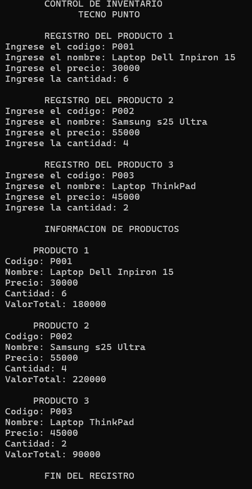
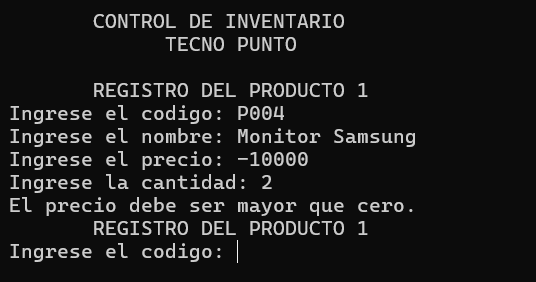
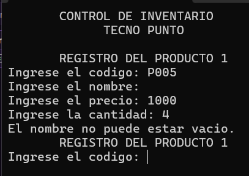
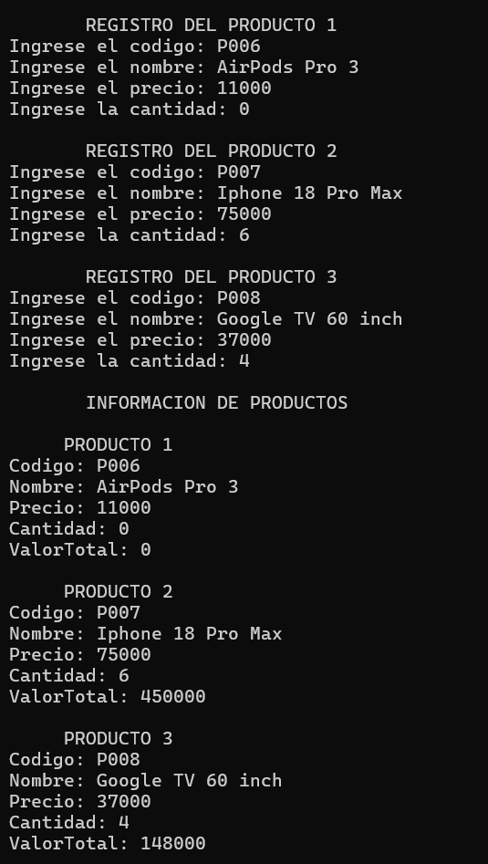

CONTROL DE INVENTARIO – TECNOPUNTO -

1. Descripción general del proyecto

El presente proyecto consiste en el desarrollo de una aplicación de consola en C#, orientada a la gestión básica de productos para el establecimiento comercial TecnoPunto.

La aplicación permite registrar la información correspondiente a tres productos mediante la introducción de sus respectivos códigos, nombres, precios y cantidades disponibles. Para organizar estos datos, se creó una clase denominada Producto, en la cual se definen los atributos y las propiedades necesarias para representar cada elemento del inventario.

El programa incorpora mecanismos de validación que permiten verificar los datos introducidos por el usuario. Entre estas comprobaciones se encuentran la obligatoriedad del nombre del producto, la restricción de precios mayores que cero y la aceptación únicamente de cantidades iguales o superiores a cero.

Asimismo, se implementa una propiedad de solo lectura denominada ValorTotal, encargada de calcular automáticamente el valor correspondiente a cada producto mediante la multiplicación de su precio por la cantidad registrada.

Finalmente, la aplicación presenta en pantalla la información de los tres productos registrados, incluyendo el valor total calculado para cada uno.

2. Objetivo del proyecto

Desarrollar una aplicación de consola que permita aplicar los fundamentos de la programación orientada a objetos en C#, mediante la creación de clases y objetos, el uso de atributos privados, propiedades, constructores y validaciones de datos.

3. Datos de entrada

Los datos de entrada corresponden a la información proporcionada por el usuario durante el registro de cada producto.

Código: Código del producto.
Nombre: Nombre del producto.
Precio: Precio del producto.
Cantidad: Cantidad disponible del producto.

La aplicación solicita estos cuatro datos para cada uno de los tres productos que se registran.

4. Datos procesados

Durante la ejecución, el programa realiza las siguientes operaciones:

4.1. Validación del nombre

Comprueba que el nombre del producto no esté vacío ni contenga únicamente espacios en blanco.

4.2. Validación del precio

Verifica que el precio introducido sea un valor numérico mayor que cero. Si no cumple esta condición, se genera un mensaje de error.

4.3. Validación de la cantidad

Comprueba que la cantidad registrada sea un número entero igual o superior a cero. No se permiten cantidades negativas.

4.4. Cálculo del valor total

Determina el valor total de cada producto mediante la siguiente operación:

Valor total = Precio × Cantidad

4.5. Creación de objetos

Utiliza el constructor de la clase Producto para inicializar los datos correspondientes a cada uno de los tres productos registrados.

5. Datos de salida

Una vez completado el registro, el programa presenta en la consola la información de cada producto, organizada individualmente.

Los resultados mostrados incluyen:

Código del producto.
Nombre del producto.
Precio.
Cantidad.
Valor total.
De esta manera, se obtiene una visualización organizada de los productos registrados y del valor correspondiente a las unidades disponibles de cada uno.

6. Estructura del proyecto

El proyecto está compuesto por los siguientes archivos principales:

Producto.cs: Contiene la definición de la clase Producto, sus atributos privados, propiedades, constructor y método para mostrar la información.

Program.cs: Contiene el método principal Main(), desde el cual se solicitan los datos, se crean los objetos y se presenta la información en pantalla.

7. Tecnologías y herramientas utilizadas

Lenguaje de programación: C#.
Entorno de desarrollo: Visual Studio Community.
Tipo de aplicación: Consola.
Paradigma de programación: Programación orientada a objetos.

8. Evidencias de funcionamiento

En esta sección se presentan las capturas de pantalla correspondientes a las pruebas realizadas para comprobar el funcionamiento de la aplicación y sus mecanismos de validación.

8.1. Registro de productos con datos válidos

8.2. Validación de precio negativo o igual a cero

8.3. Validación de nombre vacío

8.4. Registro de cantidad igual a cero

9. Integrantes del proyecto

Narelin Vittini – 2025-2618.

Vianca Liza Maldonado – 2025-3294.

Windfree Figueroa – 2017-3156.

